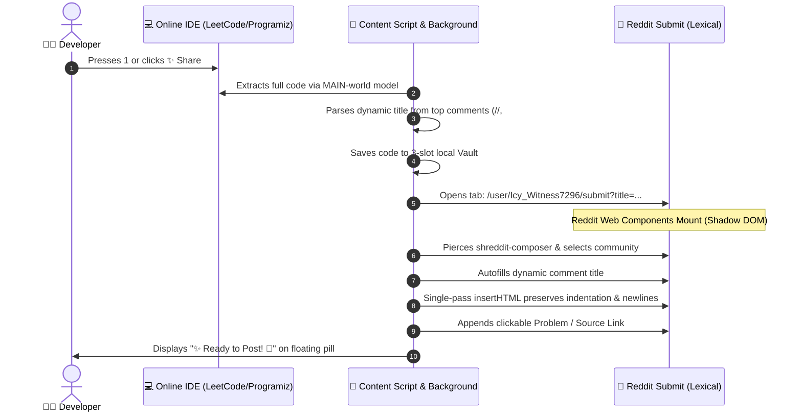

<div align="center">

# 🎀 Reddit Compiler Auto-Poster ✨

### Share 100% Formatted Solution Code, Dynamic Titles & Source Links to Reddit in One Click!

[](https://developer.chrome.com/docs/extensions/mv3/intro/)
[](https://reddit.com)
[](https://leetcode.com)
[](LICENSE)
[](https://github.com/hari45wavin/reddit-compiler-auto-poster/pulls)
[](https://github.com/hari45wavin/reddit-compiler-auto-poster/releases)
[](https://github.com/sponsors/hari45wavin)

<br/>


<br/><br/>

<p align="center">
  <b>A lightweight, privacy-focused Chromium extension with a cute Gen Z translucent anime toolbar that automatically extracts multi-line solution code, dynamically detects problem titles from code comments, pierces Reddit's Shadow DOM, and populates publication-ready posts with zero duplicate text.</b>
</p>

[Key Features](#-key-features) • [Why This Was Created](#-why-this-was-created) • [Keyboard Shortcuts](#-keyboard-shortcuts) • [Supported Compilers](#-supported-compilers--ides) • [Installation Guide](#-installation-guide) • [How It Works](#-how-it-works-under-the-hood) • [Roadmap](ROADMAP.md) • [Contributing](CONTRIBUTING.md)

---

</div>

---

## 💡 Why This Was Created

Sharing your code solutions, competitive programming answers, or debugging questions to Reddit has always been frustrating and tedious:

* 💥 **Indentation & Line Breaks Get Wrecked:** Pasting multi-line code directly into modern Reddit’s Lexical rich text editor collapses newlines, strips tabs, and turns beautiful algorithms into an unreadable wall of text.
* 🏷️ **Generic, Low-Effort Titles:** Compilers with native share buttons (like Programiz) hardcode useless default text like `"I wrote this program..."` instead of using your actual problem name.
* 🖱️ **Repetitive Community Dropdown Nav:** Every time you open Reddit’s submit page, you must manually open the community picker, search for your profile or subreddit, and click through modal overlays.
* 🔗 **Missing Problem & Compiler Links:** Readers on Reddit can't easily run or verify your code without the original compiler link or LeetCode question URL.
* 📦 **Virtual Scrolling on LeetCode:** Monaco-based editors only render visible DOM lines. Traditional scraping extensions only copy the visible snippet instead of your complete 200-line solution.

**Reddit Compiler Auto-Poster solves all of this automatically in sub-120ms.**

---

## ✨ Key Features

| Feature | Description |
| :--- | :--- |
| **🎀 Cute Anime Gen Z UI** | Floating translucent frosted-glass pill (`blur(20px)`) with a collapsible kawaii Snoo mascot icon and glowing badges. Takes up minimal screen space. |
| **⚡ 1-Click Reddit Share** | Hit hotkey **`1`** or click **✨ Share** to auto-save, extract full code, detect the title, and launch Reddit ready-to-post. |
| **💡 Dynamic Title Extraction** | Automatically reads line 1 or top-level comments (`//`, `#`, `--`, `%`, `/* */`, `""" docstrings`) and titles your Reddit post intelligently. |
| **📂 3-Slot Code Vault** | Local rolling save vault keeping your last 3 solution versions per problem URL. Instant one-click restore and snippet insertion. |
| **🏷️ Lit/Shreddit Shadow DOM Piercing** | Automatically pierces Reddit's Web Components to lock in user profile (`u/Icy_Witness7296`) and fill inputs instantly. |
| **🛡️ Safe Editor Typing Guard** | Pressing keys `1-4` while actively typing code in Monaco, Ace, or CodeMirror will **never** trigger hotkeys. |
| **🔗 Problem Link Embedding** | Automatically generates markdown fenced syntax blocks (` ```cpp `, ` ```python `) and appends clean source links. |
| **🚫 Zero Duplicate Pasting** | Verified single-pass HTML insertion guarantees your code is inserted exactly once with sub-120ms execution speed. |
| **✋ Native Post Control** | Leaves the native Reddit "Post" button ready for you to review and click — zero unwanted auto-submitting! |

---

## ⌨️ Keyboard Shortcuts

All hotkeys are guarded by `isUserTypingInEditor()` so you can code without interruptions:

| Shortcut | Action | Description |
| :---: | :--- | :--- |
| <kbd>Ctrl</kbd> + <kbd>Alt</kbd> + <kbd>R</kbd> | **Toggle Toolbar** | Expands or collapses the cute anime toolbar. |
| <kbd>1</kbd> | **✨ Share to Reddit** | Saves current code, extracts full solution, and opens Reddit submit tab. |
| <kbd>2</kbd> | **💖 Save to Vault** | Saves current editor code into the 3-slot rolling history. |
| <kbd>3</kbd> | **📂 Open Code Vault** | Opens modal with history slots and multi-language starter templates. |
| <kbd>4</kbd> or <kbd>Esc</kbd> | **✕ Minimize / Close** | Collapses the expanded bar back into the cute floating anime icon. |
| <kbd>⇄</kbd> Button | **Switch Orientation** | Toggles between Horizontal bar and Vertical dock. |
| <kbd>←</kbd> <kbd>→</kbd> <kbd>↑</kbd> <kbd>↓</kbd> | **Navigate Options** | Seamless keyboard navigation between toolbar options. |

---

## 🌐 Supported Compilers & IDEs

| Platform | Editor Technology | Extraction Technique |
| :--- | :--- | :--- |
| **LeetCode** | Monaco Editor | MAIN World Model Resolution (Bypasses virtual scrolling) |
| **Programiz** | Ace Editor | Ace Virtual Line Layer & Session Text |
| **OnlineGDB** | Ace / CodeMirror | Direct DOM Layer Extraction |
| **Replit** | CodeMirror v6 / Monaco | Session Buffer Extraction |
| **CodeChef** | Ace Editor | Multi-Line Token Parsing |
| **HackerRank** | Monaco Editor | Model AST Parsing |
| **GeeksforGeeks** | CodeMirror | Buffer Stream Resolution |
| **Any Custom IDE** | Standard `<textarea>` / CodeMirror | Automatic Fallback Heuristics |

> [!NOTE]
> Search engines, social networks, and AI tools (Google, Gemini, ChatGPT, YouTube, etc.) are strictly blacklisted in `manifest.json` to keep your browsing clean.

---

## 🏗️ How It Works (Under the Hood)



---

## 📥 Installation Guide

### Option 1: Load Unpacked (Chrome / Brave / Edge / Opera)

1. **Clone or Download the Repository:**
   ```bash
   git clone https://github.com/hari45wavin/reddit-compiler-auto-poster.git
   ```
2. **Open Extensions Page:**
   - Chrome: `chrome://extensions`
   - Brave: `brave://extensions`
   - Edge: `edge://extensions`
3. **Enable Developer Mode:**
   - Toggle the **Developer mode** switch in the top-right corner.
4. **Load Unpacked:**
   - Click **Load unpacked** in the top-left corner.
   - Select the `reddit-compiler-auto-poster` folder.
5. **Pin the Extension:**
   - Click the puzzle icon in your browser toolbar and pin **Reddit Compiler Auto-Poster** 🎀.

---

## 🎮 How to Use

1. Open any coding problem or compiler (e.g., [LeetCode](https://leetcode.com/problemset/) or [Programiz](https://www.programiz.com/cpp-programming/online-compiler/)).
2. Add a title comment on line 1 (e.g., `// Problem: Valid Palindrome` or `# Selection Sort Algorithm`).
3. Press <kbd>1</kbd> or click **✨ Share**.
4. The Reddit tab opens automatically:
   - Your profile community is pre-selected.
   - The title is filled dynamically.
   - The body contains your code in a syntax block with your problem link.
5. Review your post and click **Post**!

---

## 📂 Project Architecture

```text
reddit-compiler-auto-poster/
├── .github/
│   └── ISSUE_TEMPLATE/
│       ├── bug_report.md
│       └── feature_request.md
├── assets/
│   └── banner.svg
├── content/
│   ├── compiler.css       # Frosted-glass Gen Z styles & animations
│   ├── compiler.js        # Floating anime toolbar, hotkeys, vault logic
│   ├── reddit.css         # Reddit submit page pill styles
│   └── reddit.js          # Shadow DOM piercing & single-pass injection
├── icons/
│   ├── icon-16.png
│   ├── icon-48.png
│   └── icon-128.png
├── popup/
│   ├── popup.css
│   ├── popup.html
│   └── popup.js
├── utils/
│   ├── comment-parser.js  # Dynamic multi-language comment title parser
│   └── editor-detector.js # Monaco, Ace, and CodeMirror detector
├── background.js          # Manifest V3 service worker & redirection
├── manifest.json          # Production Manifest V3 configuration
├── CONTRIBUTING.md        # Contribution guidelines
├── CODE_OF_CONDUCT.md     # Community code of conduct
├── ROADMAP.md             # Project roadmap & milestones
├── LICENSE                # MIT License
└── README.md              # Project showcase & documentation
```

---

## 💖 Support the Project

If this extension saves you time while solving DSA problems or sharing code:

* ⭐ **Star this repository** to help others discover it!
* 🐛 **Report issues** or suggest new compilers in [GitHub Issues](https://github.com/hari45wavin/reddit-compiler-auto-poster/issues).
* 🔀 **Submit PRs** to help us support even more coding platforms!

---

## 📄 License

Distributed under the **MIT License**. See [`LICENSE`](LICENSE) for more details.

<div align="center">

Crafted with 💖 by **[Hariom Joshi](https://github.com/hari45wavin)**

</div>
